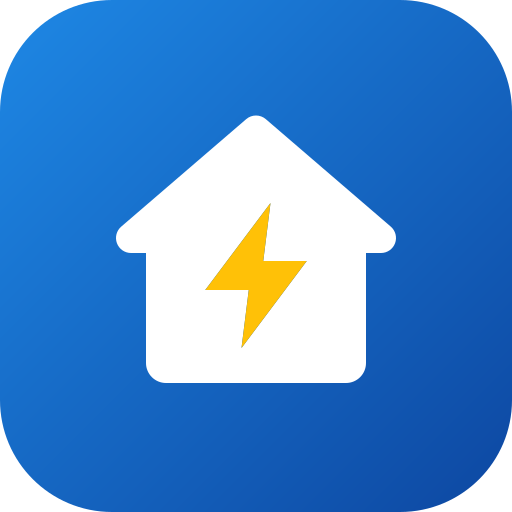

<p align="center"></p>

<h1 align="center">KI Energi for Homey</h1>

<p align="center">Strømkalkulator og smart energistyring for norske hjem.<br>
Krever Homey Pro (2023 eller nyere).</p>

KI Energi viser hva strømmen faktisk koster, og styrer varme, varmtvannsbereder og elbillading slik at du
holder deg under kapasitetstrinnet og bruker strømmen når den er billig. Alt regnes på Homey; ingen sky.

| | |
| --- | --- |
|  | **Strømkalkulator** — nettleie for 76 nettselskap, kapasitetstrinn, strømstøtte, Norgespris og kostnad for timen, dagen og måneden. |
|  | **Energimotor** — timebudsjett, rom med prioritet, værvarsel og prisoptimal varmeplan. |
| 🏠 | **Huset** — personer, bortemodus og hjemkomst, bereder, håndklevarmer, elbillading, lysregler og lærte vaner. |
| 🔗 | **Home Assistant** — integrasjonen i dette repoet kan vise og betjene appen («På Homey» i oppsettet). |

## Innhold

- [Installere](#installere)
- [Kom i gang](#kom-i-gang)
- [Skyggemodus](#skyggemodus)
- [Strømkalkulatoren](#strømkalkulatoren)
- [Energimotoren](#energimotoren)
- [Slik lærer appen](#slik-lærer-appen)
- [Huset](#huset)
- [Enheter, sensorer og widget](#enheter-sensorer-og-widget)
- [Flow-kort](#flow-kort)
- [Home Assistant](#home-assistant)
- [Lokalt API](#lokalt-api)
- [Feilsøking](#feilsøking)
- [Utvikling](#utvikling)

## Installere

**Fra testkanalen i Homey App Store** (enklest når appen er publisert dit): åpne
`https://homey.app/a/no.kristo.kienergi/test/` og trykk *Installer*.

**Med Homey CLI** fra en maskin på samme nett som Homey:

```bash
npm install -g homey      # bare første gang
cd homey
npm install
homey login
homey select
homey app install         # eller: homey app run  (viser loggen direkte)
```

## Kom i gang

1. **Legg til enhetene.** *Enheter → + → KI Energi*: først **Strømkalkulator**, så **Energimotor**.
2. **Åpne innstillingene.** *Mer → Apper → KI Energi → Konfigurer*. Siden har fem faner:

   | Fane | Hva du setter opp |
   | --- | --- |
   | **Oversikt** | Sjekkliste for oppsettet, og status for strøm, varme og huset. Trykk på et punkt for å gå til riktig fane. |
   | **Strøm** | Strømmåler (effekt, og helst kWh-register), nettselskap, boligtype, Norgespris og eventuelle egne satser. |
   | **Varme** | Motor av/på, skyggemodus, varmeplan, rommene, og grenser og døgnrytme. «Hent rom fra Homey-sonene» lager ett rom per sone med termostater. |
   | **Hjemme og borte** | Personer, bortemodus og hjemkomst. |
   | **Bereder, bil og lys** | Varmtvannsbereder, håndklevarmer, elbillading og lysregler. Alt her er valgfritt. |

   Hver fane har sin egen lagreknapp.

3. **La den gå i skyggemodus noen døgn.** Se på forklaringene på Energimotor-enheten og i widgeten.
4. **Slå av skyggemodus** når forslagene ser fornuftige ut.

Spotprisene hentes av appen selv fra hvakosterstrommen.no for nettselskapets prisområde, og værvarselet fra Yr.

## Skyggemodus

Skyggemodus er **på som standard**. Appen regner og forklarer hva den ville gjort, men rører verken termostater,
bereder, håndklevarmer, lader eller lys. Slå den av på Energimotor-enheten, i innstillingene eller med et flow-kort.

## Strømkalkulatoren

Regner på samme måte som [Strømkalkulator for Home Assistant](https://github.com/fredrik-lindseth/Stromkalkulator)
av Fredrik Lindseth (MIT). Tariffene for 76 nettselskap (`lib/tariffer.json`) og beregningsreglene er hentet derfra:

- **Forbruk:** delta fra målerens kWh-register, time for time. Uten register summeres effekten.
- **Kapasitetsledd:** nettselskapets metode. De fleste bruker snittet av de tre høyeste døgnmaksene i måneden;
  Sør Aurdal bruker månedens høyeste time, Alut og Netera hovedsikringen, Fjellnett fem sesongvektede ukestopper.
- **Energiledd:** dag er hverdager 06–22 utenom helligdager, ellers natt/helg. Noen nettselskap bruker bare klokkeslett,
  og noen har sommer- og vinterpriser.
- **Avgifter 2026:** forbruksavgift 7,13 øre, Enova 1,00 øre, mva 25 % (0 % i Nord-Norge, ingen forbruksavgift i tiltakssonen).
- **Strømstøtte:** 90 % av spotpris over 96,25 øre/kWh inkl. mva, inntil 5000 kWh per måned. Ikke for ren fritidsbolig.
- **Norgespris:** 50 øre/kWh (40 i nord), inntil 5000 kWh per måned (1000 for fritidsbolig), spotpris over taket.
- **Kostnad:** hvert intervall prises med sin egen spotpris og tariff. Kapasitetsleddet påløper jevnt over måneden.

Ikke med ennå: eksport/plusskunde, sammenligning mot strømleverandørens pris, og fakturakontrollen
(«avregning») fra originalen.

## Energimotoren

Hvert minutt:

1. **Timens grense:** det høyeste timen kan ende på uten at kapasitetsleddet går opp et trinn,
   mellom en laveste og en absolutt grense du setter.
2. **Annet forbruk:** det motoren ikke styrer læres per ukedag og time, og brukes til å anslå resten av timen.
3. **Mål per rom:** fra programmet (dag/natt), eller fra varmeplanen når rommet er lært.
4. **Fordeling:** rommene får effekt etter prioritet. Blir timen for trang, senkes de minst viktige
   noen grader, og de slippes ett om gangen når det er rom igjen. Prioritet 1 senkes aldri.

**Varmeplanen** regner for hvert lærte rom den billigste måten å holde komforten på de neste 36 timene,
med rommets egen kurve (hvor fort det varmes og kjøles), værvarselet fra Yr og prisen time for time
(kraft etter strømstøtte eller Norgespris, pluss energiledd). Det gir nattsenking bare når den lønner seg,
forvarming i billige timer, og start i tide før dagen begynner — tidligere jo kaldere det er.

**Timer der huset bruker mye** får et påslag i planen: rommene varmes litt ekstra før middagstid og andre travle
timer, så ovnene kan hvile når resten av huset trenger effekten.

## Slik lærer appen

Hvert rom får sin egen modell av fysikken, lært av det som faktisk skjer:

| Appen lærer | Hva det brukes til |
| --- | --- |
| **Oppvarmingsevne** — hvor fort ovnen løfter rommet | Når oppvarmingen må starte for å rekke morgenen eller hjemkomsten |
| **Varmetap** — hvor fort rommet faller mot utetemperaturen | Om nattsenking lønner seg, og hvor lavt rommet kan stå når huset er tomt |
| **Vind** — hvor mye tapet øker når det blåser | Tidligere start og mindre senking på vindfulle netter |
| **Sol fra øst, sør og vest** — rommet lærer selv hvor vinduene står | Mindre varme på forhånd når sola kommer til å gjøre jobben |
| **Treghet** — hvor lenge varmen bruker på å nå rommet (gulvvarme) | Gulvvarme startes timer før, panelovner like før |
| **Tap ved lufting** — når et vindu eller en dør mot ute står åpen | Varmen pauses mens det luftes |
| **Ovnens virkelige effekt** | Riktig kostnad og riktig plass i timebudsjettet |
| **Husets øvrige forbruk** — mønster per ukedag og time, og hvor forutsigbart det er | Hvor mye effekt som må holdes av, og hvilke timer planen bør unngå |

**Lærer raskt.** Et rom er vanligvis lært i løpet av et døgn. Alle målinger brukes, også når ovnen går av og på.
Termostater som bare melder i halve grader er tatt høyde for.

**Lærer av feil.** Bommer modellen mer enn den pleier — ny ovn, ny årstid, møblert om — oppdager appen det og lærer
rommet på nytt i løpet av et par døgn. Var rommet for kaldt da dagen begynte, starter den tidligere neste gang.
Bommer forbruksprognosen ofte, holder den av mer effekt.

**Kan korrigeres.** Skrur du på en termostat selv, holdes den verdien i tre timer. Gjør du den samme justeringen
tre ganger på to forskjellige dager, blir den en fast justering for dag eller natt i det rommet (høyst ±2 °C).
Under *Varme → Rom* kan du be appen glemme justeringene eller lære et rom helt på nytt.

**Sikkerhet foran sparing.**

- Til et rom er lært, følger det programmet. Trege anlegg senkes da bare 1,5 °C.
- Planen regner forsiktig: litt svakere ovn og litt større tap enn lært, og bare halvparten av den varslede sola.
  Marginen krymper etter hvert som modellen blir sikker.
- Enkeltmålinger langt utenfor det vanlige får liten vekt.
- En vindussensor som henger på «åpen» får ikke la rommet stå kaldt: etter 90 minutter varmes det igjen.
- En termostat som runder av eller melder sent, regnes ikke som en justering fra deg.

**Innsyn.** Oversikten i innstillingene viser hva appen har lært om hvert rom — varmetap i watt per grad,
tidskonstant, vind, sol og hvor sikker den er — og de siste hendelsene i læringen.

Læringen er prøvd mot et simulert hus med kjent fysikk (`test/simhus.js`): modellen finner tallene igjen, og i
lukket sløyfe er rommene varme i tide og billigere enn en vanlig termostat med samme program. Hvor mye du sparer i
ditt hus avhenger av prisene, været og hvor mye rommene får senkes.

For best resultat: effektmåling på ovnene. Uten lærer appen bare når termostaten tydelig varmer eller tydelig står.
Vindmåler og vindussensorer er valgfrie og velges under *Varme*.

## Huset

**Personer.** Hver person følger en Homey-bruker eller en ja/nei-variabel (ja = hjemme). Et rom kan følge
en person: barn har fast opp/legg og er borte på dagtid, ungdom har egen leggetid og vekking for hverdag og helg.

**Bortemodus** slår seg på når alle har vært ute lenge nok (standard 3 timer), og av i det noen kommer hjem.
Den kan også slås på for hånd, fra enheten eller et flow-kort; da står den til dere har dratt og kommet tilbake.

**Bortetemperaturen** velges for hvert lærte rom: den laveste temperaturen rommet rekker å varme seg opp fra
til dagtemperaturen innen forvarmingstiden, i det kaldeste været varselet viser — aldri under bunnen du setter
(standard 12 °C). Rom som ikke er lært, bruker faste temperaturer (16 / 18 / 22 °C).

**Hjemkomst** er når huset skal være varmt igjen: en fast ukedag og tid (standard søndag kl. 13), eller satt
med flow-kortet «Vi kommer hjem kl. …». Fordi kravet stiger på et kjent tidspunkt, starter varmeplanen
oppvarmingen i tide rom for rom. Etter tiden holdes dagtemperatur til noen kommer.
«Vi blir borte lenger» hopper over den faste hjemkomsten.

**Berederen** varmer i vinduet (standard 22–05) eller i de billigste timene, slår av når termostaten kobler ut,
og hviler når huset står tomt.

- **Varmer alltid ferdig.** Pris, effekt og klokka bestemmer når en oppvarming *starter* — aldri når den slutter.
  Releet slås først av når elementet har trukket strøm og deretter stått uten i tolv minutter, altså når berederens
  egen termostat har koblet ut. Det gjelder også etter fristen: kobler termostaten ut kl. 05:11, slås releet av
  kl. 05:23. En trang time kan utsette starten, men aldri avbryte.

- **Varmt til fristen.** Rekker ikke berederen å bli ferdig til «Ferdig innen» (standard kl. 05), varmer den uansett
  pris og effekt. Hvor lang tid den trenger, lærer appen av berederens egne oppvarminger (tre timer til den vet).
- **Morgensjekk.** Når fristen passerer, sjekkes det at termostaten har koblet ut siden vinduet åpnet. Hvis ikke,
  får du et varsel med grunnen, og flow-kortet «Berederen ble ikke varm til fristen» utløses.
- **Legionella.** Vannet skal ha vært varmt minst hver tredje dag. Går det lenger, får du et varsel, og etter sju
  dager varmes det uansett pris og effekt. Sensoren «Legionellasikret» viser status.

Sjekkene trenger et relé med effektmåling, og forutsetter at berederens termostat står på 65–70 °C. Uten
effektmåling følger berederen bare vinduet, og morgensjekken sier at den ikke kan bekrefte.

**Håndklevarmeren** står på i et morgen- og et kveldsvindu, og av når huset er tomt. Den slås av og på ved skiftene —
når et vindu åpner eller stenger, og når bortemodus slår inn eller ut. Slår du den av eller på selv i mellomtiden,
får det stå til neste skifte.

**Elbilladingen** gir bilen effekten varmen ikke bruker. Laderen trenger en av/på-bryter og en ladestrøm som kan
settes i ampere; appen velger det høyeste trinnet som får plass i timen. Den går ned med en gang huset trenger
effekten, og opp igjen først når det monner. Batterinivå med hysterese (stopp ved 80 %, start igjen under 70 %),
og «bare om natten» hvis du vil. Bilens forbruk holdes utenfor husets lærte lastprofil.

**Lysreglene** er «glemt lys» (av etter noen minutter uten bevegelse, eller etter en maks på-tid uten sensor)
og «nattdemping» (et nattnivå og et dagnivå; endrer du lysstyrken for hånd, får den stå til neste skifte).
En sensor som har falt ut regnes ikke som «ingen i rommet».

**Vanene** lærer når dere pleier å komme hjem etter en tur og når huset våkner, og foreslår endringer i
innstillingene. Lært hjemkomsttid kan brukes automatisk.

Homey-varsler kan ikke ha svarknapper, så spørsmålene fra Home Assistant-versjonen («Skal dere bort i helgen?»)
er erstattet av automatisk bortemodus og flow-kort.

## Enheter, sensorer og widget

- **Strømkalkulator** har 33 sensorer: tariff, energiledd, kapasitetstrinn, de tre toppene, margin til neste trinn,
  spotpris, strømstøtte, totalpris, forbruk og kostnad for timen, dagen og måneden, og forrige måned til å sjekke fakturaen mot.
- **Energimotor** har av/på, skyggemodus, bortemodus, utetemperatur og 17 sensorer: status og forklaring, timens grense,
  forventet og brukt, ledig, uregulert og styrt effekt, senkede rom, spart med varmeplanen, modus, hjemkomst,
  bereder (status, varmt til fristen, legionellasikret) og elbillading.
- **Widgeten** «KI Energi – oversikt» viser status, timen, prisen nå, måneden, modus og hvert rom.

Tallsensorene logges i Homey Insights.

## Flow-kort

| | Kort |
| --- | --- |
| **Når** | Kapasitetsvarsel · kapasitetstrinnet endret seg · en time er ferdig · tariffen skiftet · strømprisen endret seg · energimotorens status endret seg · et rom ble senket · bortemodus ble slått av eller på · noen kom hjem · berederen er varm · berederen ble ikke varm til fristen |
| **Og** | Tariffen er dagtariff · Norgespris er aktiv · kapasitetsvarsel er på · totalprisen er over … · energimotorens status er … · bortemodus er på · alle er borte |
| **Så** | Overstyr temperaturen i et rom · fjern overstyringen · slå skyggemodus eller bortemodus av eller på · «vi kommer hjem kl. …» · «vi blir borte lenger» · varm opp berederen nå · kjør en full oppvarming av berederen · slå automatisk elbillading av eller på |

## Home Assistant

Integrasjonen i dette repoet (`custom_components/ki_energi`, installeres med HACS) har en kontrollversjon som gjør
appen om til entiteter i Home Assistant. All beregning og styring skjer fortsatt på Homey.

1. Lag en API-nøkkel i Homey: *Innstillinger → API-nøkler*.
2. I Home Assistant: legg til **KI Energi**, velg **På Homey**, og oppgi Homeys IP-adresse og nøkkelen.

Home Assistant er da en fjernkontroll: den styrer ingen enheter selv. Oppsettet viser hva som ble funnet på Homey
før det fullføres, og sensoren «Styres fra» sier «Homey-appen».

Du får sensorer, rom som klimaenheter, brytere, tall og klokkeslett for innstillingene, og knapper for bereder og
bortemodus. Svarer ikke Homey, blir entitetene utilgjengelige og kommer tilbake av seg selv.

## Lokalt API

`http://<homey>/api/app/no.kristo.kienergi/…` med en API-nøkkel fra Homey som Bearer-token.

| Metode | Sti | Innhold |
| --- | --- | --- |
| GET | `/status` | Alt kalkulatoren viser, som JSON |
| GET | `/priser` | Spotpriser time for time, 48 t fram |
| GET | `/nettselskap` | Nettselskapene i katalogen |
| GET | `/enheter` | Enheter som kan være strømmåler |
| GET / PUT | `/innstillinger` | Les og endre innstillingene |
| GET | `/motor` | Energimotorens bilde: budsjett, rom, settpunkter og forklaringer |
| GET / PUT | `/motorinnstillinger` | Motorens innstillinger og rom |
| GET | `/termostater`, `/temperatursensorer`, `/romforslag` | Til oppsettet |
| POST | `/overstyr`, `/fjernoverstyring` | `{rom, temp, minutter}` / `{rom}` |
| POST | `/glem` | `{hva: "laering" eller "justering", rom}` — glem det som er lært |
| GET | `/hus` | Modus, personer, hjemkomst, bereder, håndklevarmer og vaner |
| GET / PUT | `/husinnstillinger` | Personer, bortemodus, bereder og håndklevarmer |
| GET | `/personkilder`, `/brytere`, `/alleenheter` | Til oppsettet |
| POST | `/bortemodus`, `/hjemkomst`, `/forleng`, `/bereder` | `{paa}` / `{tid}` / – / `{handling, minutter}` |

## Feilsøking

| Det du ser | Sannsynlig årsak og løsning |
| --- | --- |
| `homey app install` stopper med `✖ 400` | CLI-en gikk via skyadressen (`…homeypro.net`) i stedet for lokalt. Sett Mac/PC på samme nett som Homey, slå av VPN, eller koble til med USB‑C. Blokkerer ruteren oppslag av `…homey.homeylocal.com` (DNS rebind-beskyttelse), bytt DNS til f.eks. 1.1.1.1. |
| `homey app publish` klager på `README.txt` | Filen skal ligge i `homey/`. Hent siste versjon av repoet. |
| Kapasitetstrinnet er for lavt, eller toppene mangler | Appen kjenner bare forbruket fra den ble installert. Legg inn månedens tre høyeste topper fra nettselskapet under *Strøm*. Trinnet vises som «(usikkert)» til det er gjort eller en ny måned har startet. Den første målte toppen kommer når en hel klokketime er målt. |
| Berederen står på hele natta uten å trekke strøm | Vannet var alt varmt, eller releet måler ikke berederens effekt (vanlig når berederen går via en kontaktor). Uten målt strømtrekk kan ikke appen bekrefte at vannet er varmt; etter to netter får du et varsel. Oversikten viser når releet ble slått av og på, og hvorfor. |
| Ingenting styres | Skyggemodus står på, eller Energimotor-enheten er slått av. |
| Et rom følger bare programmet | Rommet er ikke lært ennå; det tar vanligvis et døgn. Uten effektmåling (W) på ovnene går det saktere. Oversikten viser hvor langt den er kommet. |
| Appen holder en temperatur du ikke har bedt om | Du (eller termostatens eget program) har endret settpunktet; det holdes i tre timer. Eller appen har lært en fast justering — se rommet under *Varme*, der kan den glemmes. |
| Forbruket står på 0 kWh og toppene oppdateres ikke | Strømmåleren gir ikke verdier, eller feil kWh-register er valgt (velg importert energi, ikke eksport). «Strøm»-kortet på oversikten viser effekten nå, registerverdien, når den sist endret seg og hva appen regner fra. Står registeret stille i to timer mens huset bruker strøm, regner appen fra effekten i stedet og sier fra. |
| Ingen priser | Sjekk at nettselskap er valgt, og at Homey har internett. |
| Home Assistant sier «avvist» eller «ingen kontakt» | Sjekk IP-adressen og at API-nøkkelen er riktig. Koblingen er ikke prøvd mot en ekte Homey ennå — meld fra hvis den ikke virker. |

## Utvikling

All beregning ligger i `lib/` uten avhengighet til Homey, og testes med `npm test`.
`app.json` bygges fra tabellene i `lib/` med `npm run bygg` — ikke rediger den for hånd. Versjonsnummeret settes i
`package.json`; svar derfor nei når `homey app publish` tilbyr å øke det, og endre det i `package.json` i stedet.

Ikonene er ensfargede SVG-er: appens i `assets/icon.svg`, enhetenes i `drivers/*/assets/icon.svg` og sensorenes i
`assets/ikoner/`. Hvilket ikon en sensor får, bestemmes av id og enhet i `scripts/lag-app-json.js`.

Tariffene og beregningsreglene kommer fra [Strømkalkulator for Home Assistant](https://github.com/fredrik-lindseth/Stromkalkulator)
av Fredrik Lindseth (MIT, se `lib/LISENS-Stromkalkulator.txt`).
